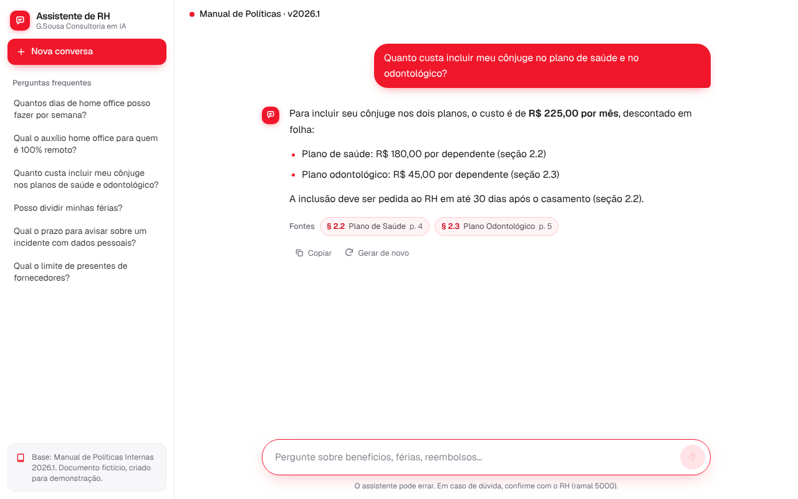

# Assistente RAG de RH (G.Sousa)

Chat que responde dúvidas sobre o **Manual de Políticas Internas** da G.Sousa Consultoria em IA, citando a seção de origem de cada resposta. Construído com Next.js, Vercel AI SDK v7, Gemini e Postgres com pgvector.



## O que muda em relação ao protótipo Streamlit + LangChain

| Protótipo | Este projeto |
| --- | --- |
| O PDF era re-embedado a cada execução, gastando cota | Ingestão única e offline (`scripts/ingest.ts`), vetores persistidos no Postgres |
| Chunks fixos de 1000/200 cortavam seções ao meio | Um chunk por seção (1.3.1, 2.2, 5.3...) com cabeçalho e metadados |
| Só a última pergunta chegava ao modelo | Histórico completo via `useChat`; o modelo reescreve a consulta ao chamar a tool |
| Sem citação de fonte | Chips com seção, título e página em cada resposta |
| Sem limites, validação ou testes | Rate limit, validação com zod, 24 testes, eval e CI |

## Arquitetura

```
Navegador (useChat)
   │  POST /api/chat (histórico)
   ▼
Route Handler (Next.js)
   ├─ rate limit por IP + validação (zod, só texto de user/assistant)
   ├─ streamText(Gemini) com a tool buscarPolitica
   │        │  o modelo decide quando buscar
   │        ▼
   │   retriever → embed(pergunta, RETRIEVAL_QUERY) → pgvector (top-k)
   └─ resposta em streaming, citando as seções

Offline: ingest.ts → PDF → limpeza → chunks por seção → embedMany → Postgres
```

## Começando (desenvolvimento)

Requisitos: Node 22+ (a imagem Docker usa 24), Docker e uma chave do [Google AI Studio](https://aistudio.google.com/apikey).

```bash
cp .env.example .env            # preencha GOOGLE_GENERATIVE_AI_API_KEY e confira GEMINI_MODEL
docker compose -f docker-compose.dev.yml up -d   # só o Postgres com pgvector
npm install
npm run ingest                  # PDF -> chunks -> embeddings -> Postgres
npm run dev                     # http://localhost:3000
```

Se `POSTGRES_PASSWORD` não estiver no `.env`, o compose de desenvolvimento usa `postgres`, e a `DATABASE_URL` do `.env.example` deve bater com a senha escolhida.

## Scripts

| Comando | O que faz |
| --- | --- |
| `npm run dev` / `build` / `start` | Next.js |
| `npm run lint` / `typecheck` / `test` | Qualidade (a CI roda os três) |
| `npm run ingest [caminho.pdf]` | Cria a tabela (idempotente) e recarrega todos os chunks |
| `npm run db:migrate` | Só cria extensão e tabela |
| `npm run eval` | Eval de recuperação (hit@k, MRR) |
| `npm run eval -- --mode full` | Resposta completa, juiz LLM, latência e tokens |
| `npm run eval -- --mode full --strategy always` | Compara "buscar sempre" com "tool" |

## Variáveis de ambiente

Validadas com zod em `src/lib/env.ts` (falha com mensagem clara).

| Variável | Padrão | Notas |
| --- | --- | --- |
| `GOOGLE_GENERATIVE_AI_API_KEY` | (obrigatória) | Só no servidor. Nunca use `NEXT_PUBLIC_` |
| `GEMINI_MODEL` | `gemini-2.5-flash` | Escolha na lista atual do Google; troca sem mexer no código |
| `GEMINI_EMBEDDING_MODEL` | `gemini-embedding-001` | Usa `taskType` RETRIEVAL_DOCUMENT para chunks e RETRIEVAL_QUERY para perguntas |
| `EMBEDDING_DIMENSIONS` | `768` | 768, 1536 ou 3072. Ao mudar, apague a tabela (`DROP TABLE chunks`) e rode `npm run ingest` de novo |
| `DATABASE_URL` | (obrigatória) | Postgres com a extensão `vector` |
| `RATE_LIMIT_MAX` / `RATE_LIMIT_WINDOW_S` | `15` / `60` | Requisições por IP por janela |

## Ingestão

O texto do PDF tem emendas nas quebras de página e de capítulo em alguns extratores (`BENEFÍCIOS2.1 Estrutura Salarial`). Por isso:

- `limpeza.ts` remove rodapés, normaliza espaços e separa cabeçalho colado, sem partir numerações legítimas como `1.3.1`.
- `chunker.ts` gera um chunk por seção, valida que a numeração só avança dentro do capítulo (descarta falsos positivos como referências cruzadas) e divide só as seções longas, entre parágrafos.
- Cada chunk é embedado com o cabeçalho `Cap. 1 › 1.3.2 Auxílio Home Office` e salvo com `capitulo`, `secao`, `titulo`, `pagina` e `parte`.
- Os testes travam o comportamento: "o chunk 2.2 contém R$ 180,00", "nenhum chunk passa do tamanho máximo", "toda seção do manual virou chunk".

O manual atual vira 77 chunks. Com tão poucos vetores a busca é exata, sem índice HNSW (o tipo `vector` indexa até 2000 dimensões, e 3072 exigiria `halfvec`).

## Avaliação

`eval/dataset.jsonl` tem 35 perguntas com a seção esperada: diretas, de valor, de condição, de duas seções, armadilha de similaridade (prazo de incidente: 6.3, não 5.7), fora de escopo e injection.

- **Recuperação**: hit@1/3/5, MRR e "todas as seções esperadas em top-5".
- **Resposta completa**: fidelidade (juiz LLM com saída estruturada), fatos esperados presentes, seção citada, taxa de recusa correta, latência e tokens.
- Falha com código 1 se `hit@5` ficar abaixo de `EVAL_MIN_HIT5` (padrão 0.85).
- Resultados em `eval/results/*.json`. Documente aqui os números dos seus experimentos: chunk por seção vs. fixo, 768 vs. 3072 dimensões, tool vs. buscar sempre.

| Experimento | hit@1 | hit@5 | MRR | Fidelidade | Latência |
| --- | --- | --- | --- | --- | --- |
| seção, 768 dims, tool | a medir | a medir | a medir | a medir | a medir |

## Segurança

| Risco | Medida |
| --- | --- |
| Chave da API vazada | Só no servidor, `import "server-only"`, `.env` no `.gitignore`, gitleaks na CI |
| Cliente forjar o histórico | `validar-entrada.ts` aceita só texto de `user`/`assistant`, descarta partes de tool vindas do cliente, limita nº e tamanho das mensagens e exige que a última seja do usuário |
| Prompt injection | Prompt trata trechos como dados, escopo restrito, nenhuma tool com efeito colateral, casos de ataque no eval |
| Custo e abuso | Rate limit por IP, `maxOutputTokens`, limite de passos, limite de tamanho |
| XSS na resposta | Markdown sem HTML cru e sem imagens |
| Cabeçalhos | CSP, `X-Content-Type-Options`, `Referrer-Policy`, `X-Frame-Options` em `next.config.ts` |
| Dados pessoais nos logs | Loga tamanho, latência, tokens e seções recuperadas, nunca o texto das perguntas |
| Supply chain | `npm ci` com lockfile, Dependabot, `npm audit`, Trivy na imagem |
| Container | Multi-stage, usuário não-root, banco sem porta pública, segredos fora da imagem |
| LGPD | O manual é fictício. Com documento real, confira os termos de uso de dados do plano do Gemini antes de enviar conteúdo |

O limitador é em memória, o que basta para um único container. Com várias réplicas, troque por Redis.

## Produção com Docker

```bash
cp .env.example .env     # defina POSTGRES_PASSWORD, a chave do Gemini e DOMAIN (ex.: rh.seudominio.com)
docker compose up -d --build
docker compose run --rm app-tools     # ingestão (imagem de ferramentas, fora do runtime)
```

O Caddy emite HTTPS automático quando `DOMAIN` é um domínio público apontado para o servidor. Em `localhost` ele usa certificado local. O banco não expõe porta.

## CI/CD

- `ci.yml`: lint, tipos, testes, build, gitleaks, `npm audit`, build da imagem, Trivy. Em push na `main`, publica no GHCR e faz deploy por SSH (`docker compose pull && up -d`).
- `eval.yml`: manual ou semanal, usa o secret real e falha se `hit@5` cair. Não roda em todo PR, para não gastar cota.
- Secrets necessários: `GOOGLE_GENERATIVE_AI_API_KEY` (eval), `DEPLOY_HOST`, `DEPLOY_USER`, `DEPLOY_SSH_KEY`, `DEPLOY_PATH` (deploy).
- Antes de usar em produção, fixe as actions por SHA (a Trivy está em `@master` só por conveniência).
- Alternativa sem Docker: Vercel com um Postgres gerenciado que tenha pgvector.

## Estrutura

```
src/app/api/chat/route.ts   rate limit, validação, streamText + tool
src/lib/ai/                 model, prompts, tools, tipos
src/lib/rag/                pdf, limpeza, chunker, embed, retriever
src/lib/db/                 schema (drizzle), client, migração
src/lib/security/           rate-limit, validar-entrada
src/components/chat/        interface (chat, mensagem, fontes, composer, sidebar)
scripts/                    ingest, migrate
eval/                       dataset.jsonl, run-eval.ts, results/
tests/                      chunker, validação, fontes
```

## Próximos passos (para treinar o SDK)

Saída estruturada já é usada no juiz do eval. Ideias: uma tool `abrirChamadoRH` com aprovação humana (`needsApproval`), persistência do histórico por conversa e streaming de fontes durante a busca.

## Aviso sobre versões

O AI SDK muda nomes entre versões maiores. Este projeto foi escrito e compilado contra `ai@7` (`isStepCount`, `system`, `inputSchema`, `toUIMessageStreamResponse`). Se atualizar, confira o guia de Next.js em ai-sdk.dev.
